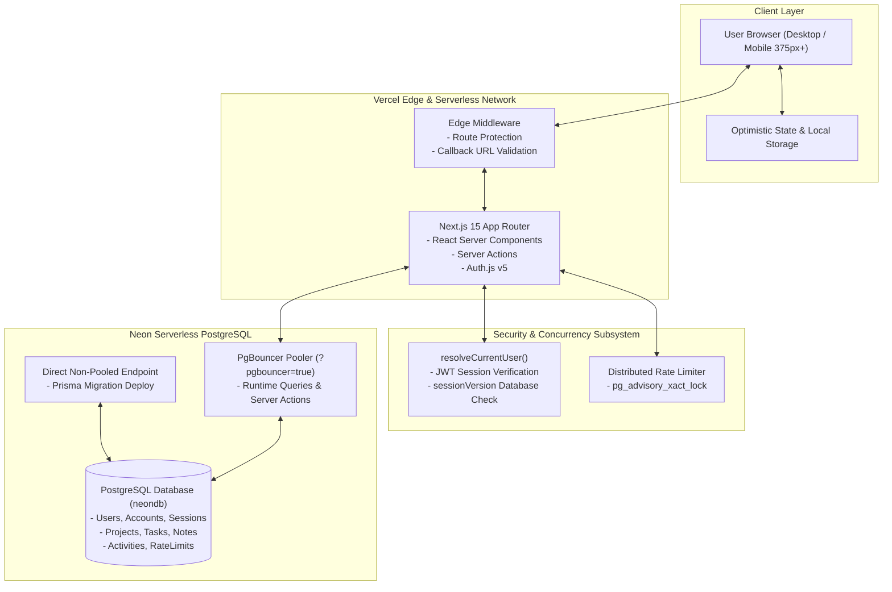

# NEXORA DevHub

<div align="center">


<br />

**Production-Grade SaaS Project & Task Management Platform for Modern Engineering Teams.**

[Live Production Demo](https://noxora-dev.vercel.app) • [GitHub Repository](https://github.com/mazen-alkhadami/noxora-dev) • [Architecture Guide](docs/ARCHITECTURE.md) • [Portfolio Case Study](docs/CASE_STUDY.md)

</div>

---

## 📖 Table of Contents

- [Overview](#-overview)
- [The Problem & The Solution](#-the-problem--the-solution)
- [Key Features](#-key-features)
- [Technology Stack](#-technology-stack)
- [Architecture Overview](#-architecture-overview)
- [UI Showcase & Screenshots](#-ui-showcase--screenshots)
- [Local Installation & Setup](#-local-installation--setup)
- [Environment Variables](#-environment-variables)
- [Database Migrations](#-database-migrations)
- [Production Deployment](#-production-deployment)
- [Verification & Quality Assurance](#-verification--quality-assurance)
- [Documentation Catalog](#-documentation-catalog)
- [Author & License](#-author--license)

---

## 🌟 Overview

**NEXORA DevHub** is an all-in-one developer workspace designed to streamline technical project execution. It unifies project tracking, sprint task management, interactive drag-and-drop Kanban boards, deadline scheduling, and rich technical notes under an enterprise-ready, multi-tenant architecture.

Built on **Next.js 15 (App Router)** and **React 19**, NEXORA DevHub pairs sub-100ms optimistic UI responsiveness with rock-solid server-side PostgreSQL persistence powered by **Neon** and **Prisma ORM**.

---

## 🎯 The Problem & The Solution

### The Problem
- **Tool Fragmentation:** Engineering workflows are often splintered across Jira (backlog), Trello (sprints), Google Calendar (milestones), and Notion (specs).
- **Multi-Tenant Vulnerabilities:** Inadequate query scoping frequently leads to accidental cross-tenant data leakage.
- **Sluggish Interfaces:** Traditional server-heavy dashboards often incur annoying page reloads or lack optimistic feedback during rapid card drags.
- **Security Deficits:** Naive authentication setups often lack session revocation, fail under distributed brute-force attacks, and expose open redirects.

### The Solution
- **Unified Engineering Hub:** Consolidates Projects, Tasks, Kanban, Schedules, and Technical Notes into a single intuitive interface.
- **Guaranteed Tenant Isolation:** Zero-trust architecture where all database operations strictly filter on authenticated user IDs resolved securely server-side.
- **Optimistic State with Resilience:** Instant drag-and-drop transitions powered by `@dnd-kit` with background Server Action synchronization and automatic rollback on network failure.
- **Hardened Security:** Distributed rate limiting with PostgreSQL advisory locks, JWT session revocation via `sessionVersion`, bcrypt hashing, and edge middleware route protection.

---

## 🚀 Key Features

| Capability | Description |
| :--- | :--- |
| **Multi-Tenant Workspace** | Complete, uncompromised data isolation for all projects, tasks, notes, and activity history. |
| **Interactive Kanban Board** | 4-stage sprint columns (`To Do`, `In Progress`, `In Review`, `Completed`) with optimistic drag-and-drop transitions. |
| **Initiative & Project Tracking** | Color-tagged project cards with dynamic progress bar calculation (% of completed tasks) and dual Grid/List views. |
| **Task Management** | Priority tiers (`Low`, `Medium`, `High`, `Urgent`), deadline scheduling, project associations, and one-click completion. |
| **Milestone Calendar** | Monthly matrix view mapping UTC ISO deadlines directly onto day cells with overdue warning indicators. |
| **TipTap Technical Notes** | Rich-text markdown documentation editor with code blocks, headings, lists, and project binding. |
| **Production Authentication** | Auth.js v5 credentials flow, atomic session versioning for instant session revocation, and edge route guards. |
| **Distributed Rate Limiting** | PostgreSQL transaction-level advisory locks protecting authentication routes across serverless instances. |
| **Adaptive Theme Engine** | High-contrast Dark and Light modes powered by `next-themes` with zero layout shift and WCAG 2.1 AA focus rings. |

---

## 🛠 Technology Stack

### Core Framework & Frontend
- **Framework:** [Next.js 15.5](https://nextjs.org/) (App Router, Server Actions, Edge Middleware)
- **UI Library:** [React 19.1](https://react.dev/) (Server & Client Components)
- **Styling:** [Tailwind CSS v4](https://tailwindcss.com/) & [shadcn/ui](https://ui.shadcn.com/)
- **Icons:** [Lucide React](https://lucide.dev/)
- **Drag-and-Drop:** [@dnd-kit/core](https://dndkit.com/) & `@dnd-kit/sortable`
- **Rich Text Editor:** [TipTap](https://tiptap.dev/) (`@tiptap/react`, `@tiptap/starter-kit`)

### Backend, Database & Security
- **Database:** [Neon Serverless PostgreSQL](https://neon.tech/)
- **ORM:** [Prisma v6](https://www.prisma.io/) (Dual pooled/direct connection strategy)
- **Authentication:** [Auth.js v5](https://authjs.dev/) (NextAuth) + `@auth/prisma-adapter`
- **Password Hashing:** `bcryptjs` (12 computational salt rounds)
- **Validation:** `zod` schema parsing
- **Testing:** Headless Chrome / [Puppeteer](https://pptr.dev/) automated browser testing

---

## 🏗 Architecture Overview

NEXORA DevHub leverages a modern serverless topology running on Vercel's global edge network and backed by Neon Serverless PostgreSQL.



> For deep architectural analysis and data models, see the [Architecture Documentation](docs/ARCHITECTURE.md).

---

## 📸 UI Showcase & Screenshots

```
┌────────────────────────────────────────────────────────────────────────┐
│  NEXORA DevHub — Workspace Dashboard                                  │
├────────────────────────────────────────────────────────────────────────┤
│  [ Projects: 4 Active ]  [ Tasks: 12 Open ]  [ Velocity: 78% Done ]   │
│                                                                        │
│  ┌─────────────────────────┐  ┌─────────────────────────────────────┐  │
│  │ Project: Cloud Platform │  │ Kanban: Sprint In-Progress          │  │
│  │ Status: ACTIVE [Indigo] │  │ [TODO: 2] [IN_PROGRESS: 3] [DONE: 5]│  │
│  │ Progress: [██████░░] 75%│  │ Task: Implement Advisory Lock (High)│  │
│  └─────────────────────────┘  └─────────────────────────────────────┘  │
│                                                                        │
│  ┌─────────────────────────┐  ┌─────────────────────────────────────┐  │
│  │ Architecture Notes      │  │ Sprint Milestone Calendar           │  │
│  │ "Dual connection pool"  │  │ November 2026: 3 Deadlines Pending  │  │
│  └─────────────────────────┘  └─────────────────────────────────────┘  │
└────────────────────────────────────────────────────────────────────────┘
```

*(Live UI screenshots can be previewed directly on the production deployment at [https://noxora-dev.vercel.app](https://noxora-dev.vercel.app).)*

---

## 💻 Local Installation & Setup

### 1. Prerequisites
- **Node.js:** v20.x or higher
- **Package Manager:** `npm` (v10+)
- **Database:** PostgreSQL instance (Neon Serverless PostgreSQL recommended)

### 2. Clone the Repository
```bash
git clone https://github.com/mazen-alkhadami/noxora-dev.git
cd noxora-dev
```

### 3. Install Dependencies
```bash
npm install
```

### 4. Configure Environment Variables
Copy the environment template:
```bash
cp .env.example .env.local
```
Update `.env.local` with your database connection strings and generate a 32-byte secret:
```bash
# Generate secret on Linux / macOS / Git Bash:
openssl rand -base64 32
```

### 5. Apply Migrations & Generate Prisma Client
```bash
npx prisma migrate deploy
npx prisma generate
```

*(Optional) Seed the database with demo engineering projects and tasks:*
```bash
npm run db:seed
```

### 6. Start Development Server
```bash
npm run dev
```
Navigate to [http://localhost:3000](http://localhost:3000) in your browser.

---

## 🔐 Environment Variables

The application relies on the following environment variables (defined with placeholders only):

```env
# ── Neon PostgreSQL Pooled Connection (Runtime Server Actions) ──
DATABASE_URL="postgres://[username]:[password]@[neon-host]-pooler.[region].aws.neon.tech/[dbname]?sslmode=require&pgbouncer=true"

# ── Neon PostgreSQL Direct Connection (Prisma Migrations) ──
DIRECT_URL="postgres://[username]:[password]@[neon-host].[region].aws.neon.tech/[dbname]?sslmode=require"

# ── Auth.js v5 Production Security Secret ──
AUTH_SECRET="[generate-with-openssl-rand-base64-32]"

# ── Application Canonical URLs ──
AUTH_URL="https://noxora-dev.vercel.app"
NEXT_PUBLIC_APP_URL="https://noxora-dev.vercel.app"

# ── Optional: Transactional Email (Resend) ──
RESEND_API_KEY="re_[your-resend-api-key]"
EMAIL_FROM="NEXORA DevHub <noreply@yourdomain.com>"

# ── Optional: OAuth Sign-In Providers ──
AUTH_GITHUB_ID="[your-github-client-id]"
AUTH_GITHUB_SECRET="[your-github-client-secret]"
AUTH_GOOGLE_ID="[your-google-client-id]"
AUTH_GOOGLE_SECRET="[your-google-client-secret]"
```

---

## 🗄 Database Migrations

NEXORA DevHub uses **Prisma Migrate** for declarative schema migrations.

```bash
# Check current migration status against database
npm run db:migrate:status

# Safely apply pending migrations in production / staging
npm run db:migrate:deploy

# Re-generate Prisma Client types
npm run db:generate
```

> [!NOTE]
> Database migrations automatically execute during Vercel builds via `"build": "prisma migrate deploy && prisma generate && next build"`.

---

## 🚀 Production Deployment

NEXORA DevHub is optimized for deployment on **Vercel** with **Neon PostgreSQL**.

1. Connect your GitHub repository to Vercel.
2. In **Project Settings > Environment Variables**, supply:
   - `DATABASE_URL` (Neon pooled endpoint with `?pgbouncer=true`)
   - `DIRECT_URL` (Neon unpooled direct endpoint)
   - `AUTH_SECRET` (32-byte secret)
   - `AUTH_URL` & `NEXT_PUBLIC_APP_URL` (`https://your-domain.vercel.app`)
3. The automated build pipeline runs `prisma migrate deploy`, applies migrations to Neon, and compiles the Next.js 15 bundle.

> For step-by-step instructions and rollback procedures, refer to the [Production Deployment Guide](docs/DEPLOYMENT.md).

---

## 🧪 Verification & Quality Assurance

The codebase enforces strict quality and type safety gates:

```bash
# Run ESLint (0 errors, 0 warnings)
npm run lint

# Run TypeScript Strict Typecheck (0 errors)
npm run typecheck

# Run Next.js 15 Production Build & Migration Verification
npm run build
```

---

## 📚 Documentation Catalog

| Document | Description |
| :--- | :--- |
| **[Project Overview](docs/PROJECT_OVERVIEW.md)** | Product vision, target personas, capabilities map, and roadmap. |
| **[Architecture Guide](docs/ARCHITECTURE.md)** | Full architectural breakdown with Mermaid diagrams and ERD. |
| **[Feature Catalog](docs/FEATURES.md)** | Detailed functional specifications for all core platform modules. |
| **[Deployment Guide](docs/DEPLOYMENT.md)** | Production deployment runbook, dual pooling setup, and rollback guides. |
| **[Portfolio Case Study](docs/CASE_STUDY.md)** | Deep-dive engineering challenges, architectural tradeoffs, and lessons learned. |

---

## 👤 Author & License

- **Lead Engineer:** Mazen Al-Khadami ([GitHub](https://github.com/mazen-alkhadami))
- **License:** Open-source under the [MIT License](LICENSE).
