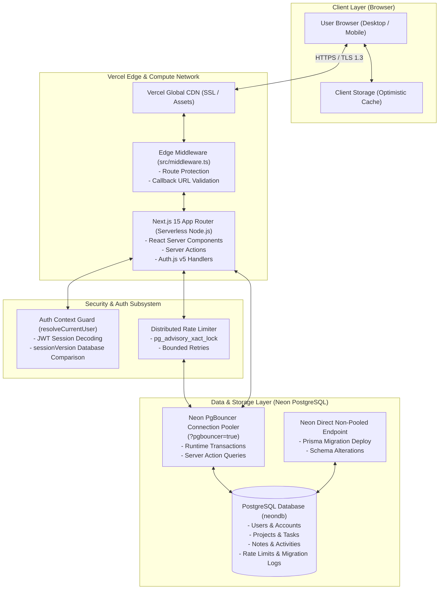
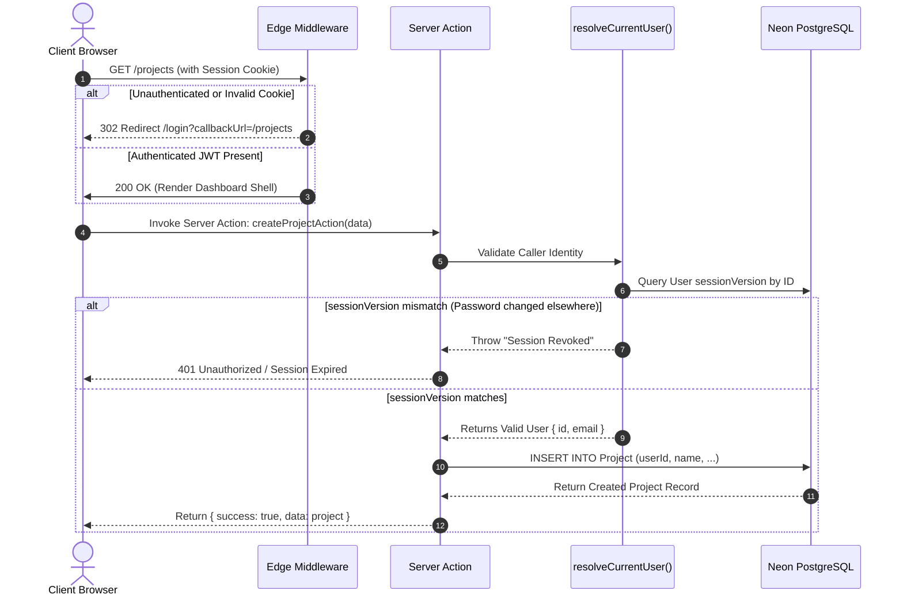
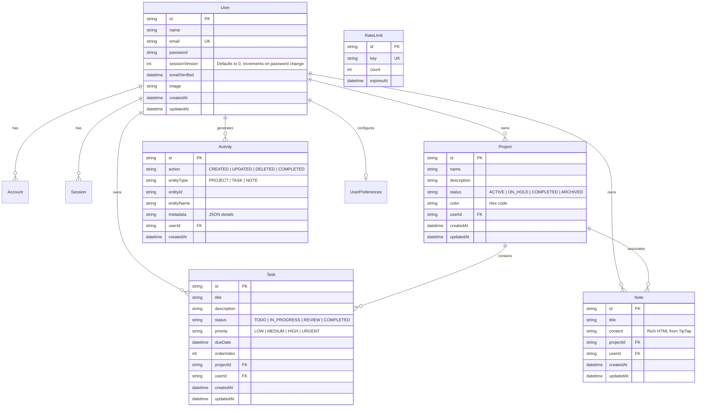

# NEXORA DevHub — System Architecture Documentation

> **Production Application:** [https://noxora-dev.vercel.app](https://noxora-dev.vercel.app)  
> **Source Repository:** [https://github.com/mazen-alkhadami/noxora-dev](https://github.com/mazen-alkhadami/noxora-dev)  
> **Architecture Pattern:** Multi-Tenant Jamstack / Serverless Full-Stack Next.js 15 App Router

---

## 1. High-Level System Topology

NEXORA DevHub is architected as a modern serverless full-stack web application hosted on Vercel's global edge network and backed by Neon Serverless PostgreSQL.



---

## 2. Request & Authentication Flow

Authentication is built with **Auth.js v5 (NextAuth)** configured with the `jwt` strategy and protected by custom session invalidation logic.



---

## 3. Database Entity Relationship Diagram (ERD)

The database schema enforces multi-tenant referential integrity. All workspace resources (`Project`, `Task`, `Note`, `Activity`, `UserPreferences`) have an explicit foreign key relationship to the parent `User`.



---

## 4. Architectural Principles & Deep-Dives

### 4.1 Strict Multi-Tenant Isolation
Multi-tenancy in NEXORA DevHub is enforced at the database level rather than through logical UI filtering.
- **Identity Resolution (`src/lib/auth-context.ts`):** Every Server Action calls `resolveCurrentUser()`, which extracts the authenticated user ID directly from the validated session.
- **Query Scoping:** Every Prisma database operation explicitly mandates `where: { userId, id }` or `where: { userId }`.
- **Cross-Tenant Prevention:** An authenticated user cannot read, update, or delete another user's projects, tasks, or notes even if the target resource ID is known.

### 4.2 Session Revocation via `sessionVersion`
Traditional stateless JWTs cannot be revoked until they expire. NEXORA DevHub solves this without converting sessions to heavy stateful database records:
1. Every user record in PostgreSQL contains a `sessionVersion: Int @default(0)` field.
2. At authentication time, `sessionVersion` is embedded into the encrypted JWT token.
3. When sensitive operations occur (e.g., password reset, profile password update), the database atomically executes:
   ```ts
   await prisma.user.update({
     where: { id: userId },
     data: { sessionVersion: { increment: 1 } },
   })
   ```
4. On subsequent Server Action invocations, `resolveCurrentUser()` verifies that the JWT's `sessionVersion` matches the current database version. Any token issued prior to the password reset is instantly rejected.

### 4.3 Distributed Advisory Rate Limiting
In a serverless environment (such as Vercel), in-memory rate limiting fails because incoming requests land on different compute instances. NEXORA DevHub implements distributed rate limiting backed by PostgreSQL:
- Uses `pg_advisory_xact_lock(hashtext(key))` within an explicit transaction.
- Locks the specific rate-limiting key for the duration of the check and increment.
- Employs bounded retries with exponential backoff if a transient serialization conflict occurs.
- Automatically clears expired rate limit windows without accumulating stale database rows.

### 4.4 Dual Connection String Architecture (Neon + Prisma)
Serverless edge functions create and tear down connections rapidly, which can overwhelm standard PostgreSQL connection limits. NEXORA DevHub employs a dual connection strategy:
- **`DATABASE_URL` (Pooled Connection):** Connects through Neon's PgBouncer pooler (`-pooler.c-3.ap-southeast-1.aws.neon.tech?pgbouncer=true`). Handles standard web queries and Server Actions efficiently.
- **`DIRECT_URL` (Direct Connection):** Connects directly to the PostgreSQL instance without PgBouncer. Required by Prisma Migrate (`prisma migrate deploy`) because database migrations require advisory locks and prepared statements that PgBouncer transaction mode prohibits.

### 4.5 Optimistic UI State Synchronization
The UI combines React 19 client state with Server Action background persistence:
1. **Immediate Reaction:** When a user creates a project, moves a Kanban card, or updates a task, `src/context/data-context.tsx` updates client state instantly and writes to local storage for offline resilience.
2. **Background Persistence:** The action dispatches the corresponding Server Action asynchronously.
3. **Reconciliation:** Upon server response, temporary client IDs are replaced with permanent database IDs. If the server action returns an error, the client automatically rolls back to the previous snapshot.
