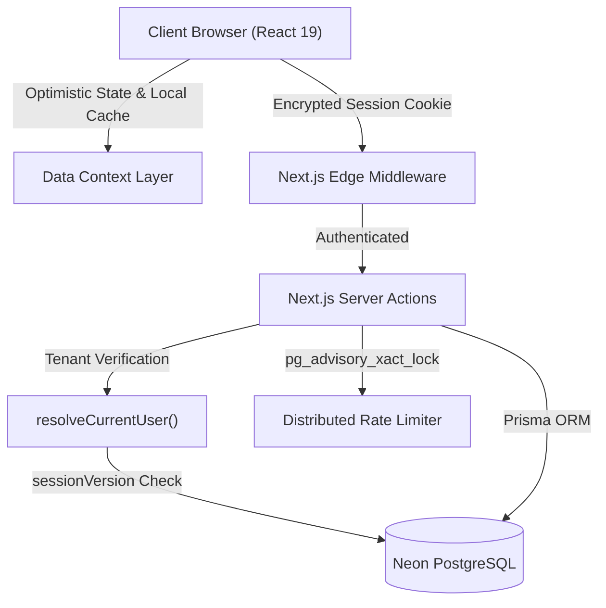
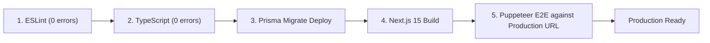

# Portfolio Case Study: Engineering NEXORA DevHub

> **Project:** NEXORA DevHub — Production-Grade SaaS Project & Task Management  
> **Author & Lead Engineer:** Mazen Al-Khadami  
> **Live Application:** [https://noxora-dev.vercel.app](https://noxora-dev.vercel.app)  
> **GitHub Repository:** [https://github.com/mazen-alkhadami/noxora-dev](https://github.com/mazen-alkhadami/noxora-dev)  
> **Tech Stack:** Next.js 15, TypeScript, Tailwind CSS v4, Prisma, Neon PostgreSQL, Auth.js v5, Vercel

---

## 1. Project Overview & Motivation

Modern engineering teams face an acute productivity tax: the fragmentation of sprint tooling. Project backlogs live in Jira, sprint planning happens on Trello, architectural documentation is scattered across Notion, and team milestones sit in calendar apps.

**NEXORA DevHub** was engineered to solve this fragmentation by delivering a unified, high-performance developer workspace. The core requirements were clear:
- Deliver an all-in-one developer workspace with zero layout shifts and sub-100ms UI interactions.
- Provide strict, unbreakable multi-tenant data isolation.
- Guarantee enterprise-grade security (distributed rate limiting, session revocation, safe redirects).
- Achieve a fully automated, production-grade CI/CD pipeline on Vercel and Neon PostgreSQL.

---

## 2. Key Technical Challenges & Engineered Solutions

### Challenge 1: Serverless Database Connection Exhaustion
* **The Problem:** Serverless edge functions spawn dynamically upon traffic surges. If each serverless instance opens a dedicated PostgreSQL connection, Neon's database connection limit is rapidly exhausted, resulting in catastrophic `ECONNREFUSED` or timeout errors.
* **The Solution:** Implemented a **Dual Connection String Strategy**. Standard application queries and Server Actions route through Neon's PgBouncer connection pool (`DATABASE_URL` with `?pgbouncer=true`), which pools thousands of requests into a handful of persistent database connections. For Prisma migrations, which require prepared statements and advisory locks incompatible with PgBouncer, a separate `DIRECT_URL` is dedicated exclusively to build-time schema migrations.

### Challenge 2: Distributed Rate Limiting in Serverless Architecture
* **The Problem:** In-memory rate limiting (like `Map` or `LRU-cache`) fails in serverless environments because successive HTTP requests are distributed across distinct Node.js execution environments. An attacker could bypass limits by spreading brute-force attempts across multiple instances.
* **The Solution:** Engineered a database-backed distributed rate limiter using **PostgreSQL Transaction-Level Advisory Locks** (`pg_advisory_xact_lock(hashtext(key))`). By acquiring an advisory lock on the hash of the target IP or email during the transaction, concurrent requests are serialized safely. A bounded retry loop with exponential backoff handles serialization conflicts without blocking serverless event loops.

### Challenge 3: Stateless JWT Session Invalidation
* **The Problem:** Stateless JWTs are widely preferred in serverless applications for their zero-database-lookup speed, but they suffer from a well-known vulnerability: once issued, a stolen or invalidated JWT remains valid until its expiration timestamp, even if the user changes their password.
* **The Solution:** Designed an **Atomic Session Versioning Pattern**. Every user record maintains a `sessionVersion: Int @default(0)` field. The version is embedded into the JWT payload upon authentication. When a password is changed or reset, PostgreSQL atomically increments `sessionVersion`. During Server Action execution, `resolveCurrentUser()` compares the JWT version against the database record; any mismatch immediately aborts the transaction and revokes access.

### Challenge 4: Optimistic UI with Drag-and-Drop Reliability
* **The Problem:** Network latency during Kanban card drags degrades user experience. Waiting for a server roundtrip before rendering a column move makes the board feel laggy, but naive optimistic updates can desynchronize if the network drops.
* **The Solution:** Built a resilient optimistic state layer in `data-context.tsx`. Column updates re-render instantly on drag release while writing to browser local storage. The Server Action (`moveTaskAction`) dispatches in the background. If the server action succeeds, the state is reconciled; if it fails, the context rolls back gracefully and displays an inline toast notification.

---

## 3. Architecture Decisions

1. **Next.js 15 App Router & Server Actions:** Selected over traditional REST/GraphQL APIs to eliminate boilerplate endpoint code, gain automatic typesafe RPC contracts, and benefit from Next.js server-side caching and dead-code elimination.
2. **Prisma ORM with Neon Serverless PostgreSQL:** Provides compile-time typesafety across all database operations with declarative schema migrations and strict relation constraints.
3. **Tailwind CSS v4 & shadcn/ui:** Facilitated high-fidelity, accessible UI components with zero runtime CSS bundle overhead and automated dark/light mode token switching.

---

## 4. Security Implementation & Hardening

- **Multi-Tenant Scoping:** Zero cross-tenant leakage. Every query filters strictly on `userId`.
- **Password Security:** Salted and hashed using `bcryptjs` with 12 computational cost rounds.
- **Route Protection:** Edge middleware blocks unauthenticated requests to `/dashboard/*` before running heavy page bundles.
- **Open-Redirect Hardening:** Sanitizes callback URLs to eliminate protocol-relative (`//attacker.com`) and backslash (`\attacker.com`) redirect vectors.
- **Cookie Hardening:** Configured with `__Secure-` prefixes, `HttpOnly`, `SameSite=Lax`, and `Secure` flags on production HTTPS.

---

## 5. Testing, Verification & Deployment Pipeline

A strict automated quality assurance suite was built to verify production readiness:

- **Automated Headless Chrome Testing:** Real Puppeteer tests executed against `https://noxora-dev.vercel.app` verified live user registration, session persistence across page reloads, and multi-tenant isolation across isolated browser contexts.
- **Zero Hydration Errors:** Stringent hydration audits verified zero React hydration warnings across dark/light themes and responsive viewports.
- **Mobile Responsiveness:** Verified zero horizontal scroll overflow at `375px` (iPhone SE) and full touch-target compliance (minimum 44×44px).

---

## 6. Key Engineering Lessons

1. **Deploy Migrations at the Build Gate:** Incorporating `prisma migrate deploy` into `package.json`'s build script (`"build": "prisma migrate deploy && prisma generate && next build"`) eliminates the risk of deploying application code before database migrations are applied.
2. **Treat Rate Limiting as a Distributed System Problem:** Relying on in-memory counters in a serverless environment creates a false sense of security. Utilizing PostgreSQL advisory locks provides guaranteed atomicity without the overhead of maintaining a separate Redis cluster.
3. **Optimistic UI Requires Deterministic Rollbacks:** Optimistic updates must be paired with deterministic rollback mechanisms and localized caching to prevent data drift during intermittent mobile network dropouts.

---

## 7. Conclusion

NEXORA DevHub demonstrates end-to-end full-stack software craftsmanship: architected for reliability, engineered with zero-trust multi-tenancy, hardened against modern web attack vectors, and validated with automated browser testing.
